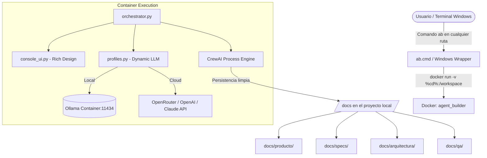

# 📘 Manual de Usuario — Agent Builder CLI (`ab`)
> **Software Factory Autónoma Multi-Agente con CrewAI, Docker y Spec-Driven Development (SDD)**  
> *Versión 2.0 — Guía Integral de Operación y Arquitectura*

---

## 📑 Tabla de Contenidos
1. [Introducción y Propósito](#1-introducción-y-propósito)
2. [Arquitectura del Sistema](#2-arquitectura-del-sistema)
3. [Instalación y Configuración Inicial](#3-instalación-y-configuración-inicial)
4. [Ciclo de Vida de un Proyecto (Flujo Paso a Paso)](#4-ciclo-de-vida-de-un-proyecto-flujo-paso-a-paso)
5. [Referencia de Comandos CLI (`ab`)](#5-referencia-de-comandos-cli-ab)
6. [Human-in-the-Loop: Resolución de Preguntas Abiertas](#6-human-in-the-loop-resolución-de-preguntas-abiertas)
7. [Organización de Archivos Generados (`docs/`)](#7-organización-de-archivos-generados-docs)
8. [Gestión de Perfiles y Modelos LLM](#8-gestión-de-perfiles-y-modelos-llm)
9. [Resolución de Problemas (Troubleshooting)](#9-resolución-de-problemas-troubleshooting)

---

## 1. Introducción y Propósito

**Agent Builder** es una factoría de software autónoma que simula una célula ágil de ingeniería completa. En lugar de generar código a ciegas a partir de un prompt simple, Agent Builder coordina múltiples agentes especializados mediante **CrewAI**:

- **Product Owner (PO):** Define alcance, prioriza backlog (MoSCoW) y aprueba entregables.
- **Analista de Requerimientos:** Redacta el PRD e Historias de Usuario INVEST con escenarios BDD/Gherkin (`Dado/Cuando/Entonces`).
- **Revisor INVEST:** Audita la calidad y trazabilidad de requerimientos.
- **Facilitador de Refinamiento:** Prepara los paquetes técnicos para ingeniería.
- **Líder Técnico & Desarrolladores:** Evalúan viabilidad, diseñan arquitectura C4 e implementan código.
- **Equipo de QA (Junior, Semi, Automatización, Líder):** Diseñan planes de prueba, analizan riesgos y automatizan suites Playwright y API.
- **DevOps / Infraestructura:** Proveen entornos, Dockerfiles, pipelines CI/CD y observabilidad.

Todo el entorno se ejecuta encapsulado en contenedores Docker y puede invocarse desde cualquier terminal de Windows (`cmd`, `PowerShell`) parándose en **cualquier carpeta del disco**.

---

## 2. Arquitectura del Sistema



### Componentes Clave:
1. **`ab.cmd` / `agent-builder.cmd`:** Ubicados en `C:\Users\duvan\bin\` (en el `PATH` de Windows). Montan automáticamente la carpeta actual (`%cd%`) en `/workspace` dentro del contenedor.
2. **Contenedor `agent_builder-agent_builder`:** Imagen Docker ultraligera con Python 3.11, `uv`, `crewai` y las definiciones de los agentes en `.jsonc`.
3. **Contenedor `agent_builder_ollama`:** Servicio Docker para modelos locales rápidos en red interna `agent_builder_net`.
4. **Rich Console UI (`console_ui.py`):** Formateo visual con banners, tablas estilizadas, paneles de decisión y prompts interactivos.

---

## 3. Instalación y Configuración Inicial

### Requisitos Previos:
- **Docker Desktop** iniciado y funcionando.
- **API Key** (si usás proveedores cloud como OpenRouter, OpenAI o Anthropic).

### Configuración de Entorno (`.env`):
El archivo de configuración principal se encuentra en:
`C:\Users\duvan\Proyectos\Agent Builder\agent_builder\.env`

```ini
# Perfil por defecto: openrouter, local, openai, claude
MODEL_PROFILE=openrouter

# OpenRouter (Recomendado para velocidad y costo)
OPENROUTER_API_KEY=tu_api_key_aqui
OPENROUTER_BASE_URL=https://openrouter.ai/api/v1
OPENROUTER_MODEL=meta-llama/llama-3.1-8b-instruct

# Ollama Local (En red Docker)
OLLAMA_BASE_URL=http://agent_builder_ollama:11434
LOCAL_MODEL=llama3.2:3b
```

---

## 4. Ciclo de Vida de un Proyecto (Flujo Paso a Paso)

### 🚀 Flujo Rápido Recomendado (Fase 1 en 3 Pasos):

Para arrancar un proyecto desde cero, creás una carpeta vacía y ejecutás los 3 pasos esenciales:

```cmd
# Crear y entrar a la carpeta de tu nuevo proyecto
mkdir "C:\Users\duvan\Proyectos\MiNuevoApp"
cd "C:\Users\duvan\Proyectos\MiNuevoApp"

# ── PASO 1: Decir la idea ──────────────────────────────────────────────────
ab idea "Quiero una plataforma de reservas para canchas de fútbol con pagos y notificaciones"
# Genera el PRD, historias de usuario y muestra en consola el RESUMEN EJECUTIVO:
# 🎯 Propósito y Visión
# 📋 Funcionalidades Core (Must Have)
# ⚖️ Decisiones Clave y Supuestos
# 🚦 Estado del Backlog (Aceptado / Devuelto / Con Reservas)
#
# Y te pregunta en pantalla:
#   [1] Aceptar propuesta (y te ofrece refinar de una vez)
#   [2] Modificar / Cambiar rumbo (escribís tus cambios y el sistema replantea el PRD)
#   [3] Responder preguntas abiertas del equipo

# ── PASO 2: Aceptar / Ajustar la propuesta (si no lo hiciste en el paso 1) ─
ab aceptar
# O si querés cambiar algo en una sola línea:
# ab feedback "No quiero pagos con tarjeta, usar solo efectivo y agregar canchas de pádel"

# ── PASO 3: Refinar autónomamente (PO ➔ Dev ➔ QA ➔ Consolidación) ─────────
ab refinar
# ¡El sistema orquesta a todos los equipos solos sin que tengas que llamarlos!
# 1. PO prepara el paquete técnico.
# 2. Team Dev analiza viabilidad, dependencias y story points.
# 3. Team QA analiza riesgos de negocio, testabilidad y automatización.
# 4. PO consolida todo el feedback y emite la PROPUESTA TÉCNICA DEFINITIVA.
# Genera: docs/specs/tasks.md, docs/producto/historias_refinadas.md,
#         docs/arquitectura/respuesta_desarrollo.md, docs/qa/respuestas_qa.md
```

🏆 **¡Con estos 3 pasos la Fase 1 (Definición y Refinamiento) queda 100% completada!**

---

### 🧱 Siguiente Etapa (Fase 2: Arquitectura y Pruebas):
Una vez que tenés la propuesta definitiva refinada, avanzás con el diseño y construcción:

```cmd
# 1. Diseñar arquitectura técnica C4 y contratos
ab dev disenar

# 2. Preparar el plan de pruebas por riesgo
ab qa preparar

# 3. Construir código fuente
ab dev implementar

# 4. Validar calidad de entrega
ab qa validar
```

---

## 5. Referencia de Comandos CLI (`ab`)

Podés usar el comando corto `ab` o el largo `agent-builder`. Ambos aceptan los mismos parámetros.

### 🌟 Atajos de Alto Nivel (Recomendados):
| Comando | Descripción | Qué hace por detrás |
|---|---|---|
| `ab idea "<idea>"`<br>*(Alias: `ab po definicion`)* | **Paso 1:** Decir la idea inicial. | Genera PRD, historias INVEST, auditoría y backlog inicial. |
| `ab aceptar`<br>*(Alias: `ab responder`, `ab feedback`)* | **Paso 2:** Responder dudas y aceptar propuesta. | Abre el diálogo interactivo para afinar el backlog. |
| `ab refinar`<br>*(Alias: `ab refinamiento`)* | **Paso 3:** Refinamiento técnico automático. | Llama en cadena a **PO (preparar) ➔ Dev (estimar) ➔ QA (auditar) ➔ PO (consolidar)** sin comandos intermedios. |

### 📌 Comandos Granulares del Product Owner (PO):
| Comando | Descripción | Archivos Resultantes |
|---|---|---|
| `ab po definicion "<idea>"` | Analiza la idea de negocio, redacta el PRD, desglose de Historias INVEST y emite dictamen del backlog. | `docs/producto/prd.md`<br>`docs/producto/historias_de_usuario.md`<br>`docs/producto/auditoria_calidad.md`<br>`docs/producto/backlog_final.md` |
| `ab po responder`<br>*(Alias: `ab aceptar`)* | Inicia el prompt interactivo Human-in-the-Loop para responder preguntas abiertas y reestructurar el backlog a `Aceptado`. | Actualiza PRD, Historias y Backlog Final. |
| `ab po preparar` | Prepara el paquete de preguntas técnicas para Dev, QA e Infra. | `docs/producto/paquete_refinamiento.md` |
| `ab po consolidar` | Integra las respuestas técnicas de Dev y QA, asigna Story Points y emite la propuesta definitiva. | `docs/producto/historias_refinadas.md`<br>`docs/specs/tasks.md` |

### 🛠️ Comandos de Desarrollo (DEV):
| Comando | Descripción | Archivos Resultantes |
|---|---|---|
| `ab dev refinamiento` | Analiza viabilidad técnica, dependencias de librerías y estimación de esfuerzo. | `docs/arquitectura/respuesta_desarrollo.md` |
| `ab dev disenar` | Diseña la arquitectura C4 (Contexto, Contenedores, Componentes), modelo de datos y contratos OpenAPI. | `docs/arquitectura/arquitectura.md`<br>`docs/arquitectura/solicitud_infraestructura.md` |
| `ab dev implementar` | Asigna tareas a los devs (Senior, Semi, Junior, Frontend) y genera el código fuente y entrega para QA. Al terminar, materializa automáticamente los archivos en disco. | `docs/arquitectura/entrega_qa.md`, `docs/bundle.md` y archivos físicos en `src/`, `tests/`. |
| `ab dev extraer`<br>*(Alias: `ab extraer`, `ab codigo`)* | Extrae y materializa todos los bloques de código fuente en archivos físicos reales en disco (`src/`, `tests/`, etc.), genera scaffolding y valida la sintaxis. | Archivos físicos en `src/`, `tests/`, `requirements.txt`, `README.md`, `.env.example`. |
| `ab dev corregir` | Triage de defectos encontrados por QA, corrección de bugs y re-entrega. | `docs/arquitectura/reentrega_qa.md` |

### 🧪 Comandos de Calidad (QA):
| Comando | Descripción | Archivos Resultantes |
|---|---|---|
| `ab qa refinamiento` | Evalúa riesgos de testing, requerimientos de testabilidad (mocks/stubs) y estrategia de automatización. | `docs/qa/respuestas_qa.md` |
| `ab qa preparar` | Genera la matriz de pruebas por riesgo, diseña casos de prueba y define criterios de aceptación. | `docs/qa/plan_pruebas.md`<br>`docs/qa/revision_casos.md` |
| `ab qa preparar_ejecucion` | Valida criterios de entrada del código de Dev y genera scripts de automatización con Playwright y API tests. | `docs/qa/hoja_ejecucion.md`<br>`docs/qa/scripts_automatizacion.md` |
| `ab qa validar` | Analiza resultados de ejecución, registra defectos con severidad y emite el dictamen de calidad. | `docs/qa/reporte_qa.md`<br>`docs/qa/dictamen_qa.md` |
| `ab qa reverificar` | Reprueba defectos corregidos por Dev, ejecuta suite de regresión y emite dictamen final de release. | `docs/qa/dictamen_final_qa.md` |

### ⚙️ Comandos Generales y de Utilidad:
- `ab list`: Lista todos los agentes disponibles y el modelo LLM que tienen asignado en el perfil activo.
- `ab --help`: Muestra la ayuda rápida en terminal.
- `ab --profile <nombre>`: Ejecuta el comando forzando un perfil de modelo específico (ej. `ab --profile local po definicion "..."`).

---

## 6. Human-in-the-Loop: Resolución de Preguntas Abiertas

Cuando ejecutás `ab po definicion`, los agentes tienen la regla de **no inventar información crítica de negocio**. Si hay ambigüedades (métodos de pago, alcance geográfico, normativas), las registrarán como **Preguntas Abiertas** y el Backlog quedará en veredicto `Devuelto` o `Aceptado con reservas`.

### Cómo interactuar con `ab po responder`:
1. Ejecutás `ab po responder` en tu consola.
2. El sistema muestra un panel con las preguntas numeradas.
3. Ingresás tu respuesta en lenguaje natural para cada una.

> [!TIP]
> **¿Qué pasa si no entendés una pregunta o no sabés qué responder?**  
> ¡No tenés que ser técnico! Podés responder:  
> - *"No sé, recomendame la mejor opción estándar de la industria."*  
> - *"Usá lo más simple para un MVP en mi ciudad."*  
> - *"Omitir por ahora, dejá la opción básica."*  
> El Analista de Requerimientos y el Product Owner convertirán tu frase en una decisión formal y reestructurarán los documentos para dejar el Backlog **Aceptado**.

---

## 7. Organización de Archivos Generados (`docs/`)

Agent Builder organiza automáticamente todos los entregables en subcarpetas temáticas dentro de `docs/`. De esta forma, **la raíz de tu repositorio queda 100% limpia** para el código fuente, README y configuraciones del proyecto:

```text
TuProyecto/
├── .intercambio/                       # Archivos temporales de sincronización entre equipos
│   └── paquete_refinamiento.md
├── docs/                               # Toda la documentación viva del proyecto
│   ├── bundle.md                       # Resumen unificado legible de todas las fases
│   ├── bundle.json                     # JSON con todos los artefactos para visualizadores/APIs
│   │
│   ├── producto/                       # Fase de Negocio y Product Management
│   │   ├── prd.md                      # Product Requirements Document
│   │   ├── historias_de_usuario.md     # Historias INVEST con criterios Given-When-Then
│   │   ├── auditoria_calidad.md        # Reporte de revisión INVEST
│   │   ├── backlog_final.md            # Backlog priorizado (MoSCoW) y dictamen del PO
│   │   ├── paquete_refinamiento.md     # Preguntas preparadas para los equipos de ingeniería
│   │   └── historias_refinadas.md      # Historias consolidadas con estimaciones y DoD
│   │
│   ├── specs/                          # Especificaciones canónicas SDD (Spec-Driven Dev)
│   │   ├── proposal.md                 # Propuesta inicial formal
│   │   └── specs.md                    # Especificación técnica detallada
│   │
│   ├── arquitectura/                   # Ingeniería y Desarrollo
│   │   ├── respuesta_desarrollo.md     # Estimación, dependencias y stack propuesto
│   │   ├── arquitectura.md             # Diagramas C4, modelo de datos y endpoints
│   │   └── solicitud_infraestructura.md# Requisitos de servidores, DB y variables de entorno
│   │
│   └── qa/                             # Calidad y Testing
│       ├── respuestas_qa.md            # Riesgos de testing y testabilidad
│       ├── plan_pruebas.md             # Matriz de casos de prueba y cobertura
│       ├── scripts_automatizacion.md   # Scripts de automatización (Playwright / API)
│       └── dictamen_qa.md              # Dictamen de calidad y defectos detectados
│
└── src/ (o código del proyecto)        # Se genera durante la fase de implementación
```

---

## 8. Gestión de Perfiles y Modelos LLM

Agent Builder soporta ejecución híbrida: podés usar modelos locales sin costo con Ollama o modelos cloud de alta capacidad.

### Perfiles Preconfigurados (`profiles.py`):
1. **`openrouter` (Default recomendado):**
   - Usa `meta-llama/llama-3.1-8b-instruct` o `deepseek/deepseek-chat`.
   - Excelente relación velocidad/calidad con costo casi nulo o créditos gratuitos.
2. **`local` (100% Offline / Gratuito):**
   - Se conecta al contenedor `agent_builder_ollama`.
   - Utiliza `llama3.2:3b` o `qwen2.5:7b`.
3. **`openai`:** Modelos GPT-4o / GPT-4o-mini.
4. **`claude`:** Modelos Anthropic Claude 3.5 Sonnet.

### Cómo alternar perfiles:
- **Globalmente:** Cambiando `MODEL_PROFILE=local` en el archivo `.env`.
- **Por comando:** Agregando la bandera `--profile`:
  ```cmd
  ab --profile local po definicion "Mi proyecto local"
  ab --profile openrouter hagamos el refinamiento
  ```

---

## 9. Resolución de Problemas (Troubleshooting)

### ❓ "El comando `ab` no se reconoce en CMD"
- Asegurate de que la ruta `C:\Users\duvan\bin\` esté agregada a la variable de entorno `PATH` de Windows.
- Si recién la agregaste, cerrá y volvé a abrir tu terminal CMD.

### ❓ "Error: Connection error / Name or service not known"
- **Causa:** Corte momentáneo de internet o fallo de DNS al consultar OpenRouter / OpenAI.
- **Solución:** Verificá tu conexión a internet o probá ejecutando con el perfil local: `ab --profile local <comando>`.

### ❓ "Solo veo `bundle.md` y no los archivos individuales"
- **Causa:** En versiones previas, un bug interno de CrewAI eliminaba el slash inicial de las rutas absolutas.
- **Solución:** Ya fue completamente solucionado en la versión 2.0. El orquestador cuenta con un mecanismo de autorrecuperación (`recuperar_desde_bundle_si_necesario`) que reconstruye los entregables automáticamente en `docs/`.

---
*Manual generado para el entorno de desarrollo de Carlos Ojeda — Agent Builder v2.0.*
